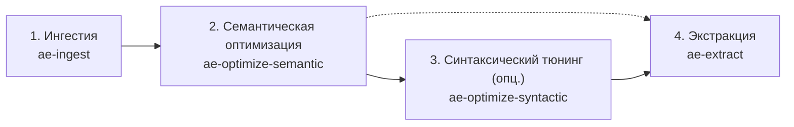

# Adaptive Extractor

Мультимодальная система извлечения структурированных научных данных из PDF-статей по декларативной YAML-схеме. Система автоматически адаптируется под новый домен на основе эталонной разметки (*Ground Truth*), устраняя необходимость вручную переписывать промпты и обучать специализированные NER/CV-модели.

## Ключевой результат

| Метрика (`benzimidazole_antibiotics`, `val`) | Базовый промпт | Семантическая оптимизация (`n=3`) | Прирост |
| :--- | :---: | :---: | :---: |
| Macro-F1, строгое совпадение | 0.8434 | **0.9803 ± 0.0031** | **+13.69 п.п.** |
| Macro-F1, смысловое совпадение (LLM-судья) | 0.9460 | **0.9942 ± 0.0031** | **+4.82 п.п.** |

## Архитектура конвейера



1. **Ингестия (`ae-ingest`)** — оцифровывает текст PDF в Markdown и заменяет иллюстрации адресными заглушками без лишнего вызова VLM для нерелевантных рисунков.
2. **Семантическая оптимизация (`ae-optimize-semantic`)** — итеративно выводит скрытые правила домена и уточняет ограничения схемы по эталонной таблице с подключением эксперта (HITL) на спорных кейсах.
3. **Синтаксический тюнинг (`ae-optimize-syntactic`, опционально)** — подбирает формулировки и `few-shot`-примеры через байесовский поиск DSPy MIPROv2 под выбранную модель.
4. **Пакетная экстракция (`ae-extract`)** — запускает ReAct-агента, который точечно распознаёт только нужные таблицы, графики и молекулы (`parse_visuals`, RDKit-валидация с OCSR-оракулом) и формирует валидированный JSON.

## Быстрый запуск

Требуется Python ≥ 3.12 и `uv`. Полная инструкция, настройка `.env` и патчи для DSPy описаны в [docs/guide.md](docs/guide.md).

Рекомендуемый стек: `gemini-3.8-flash` для ингестии, экстракции и `Student`, `qwen/qwen3.5-397b-a17b` (OpenRouter) для семантической оптимизации и `Teacher` — подробнее по модулям в [docs/guide.md](docs/guide.md#рекомендуемый-стек-моделей-по-модулям).

```bash
uv venv --python 3.12 && source .venv/bin/activate
uv pip install -e ".[chemistry,development]"
cp .env.example .env   # Укажите GEMINI_API_KEY и OPENROUTER_API_KEY

ae-ingest
ae-optimize-semantic run
ae-extract --agent data/processed/agents/agent_<timestamp>.json --split test

pytest tests/unit -q
```

## Структура проекта

```text
adaptive-extractor/
├── config/          # YAML-конфиги стадий и схема/инструкция текущей задачи
├── src/ae/          # Доменно-независимое ядро и предметные плагины
├── tests/           # Unit-, integration- и e2e-тесты
├── scripts/         # CLI-обёртки, патчи DSPy и утилиты работы с GT
├── docs/            # Документация, методология, журнал R&D и литобзор
├── research/        # Эксперименты (experiments/), ноутбуки (notebooks/) и PDF-библиотека (references/)
└── data/            # Локальные датасеты (datasets/) и рабочие данные пайплайна
```

## Документация

- [docs/architecture.md](docs/architecture.md) — устройство подсистем, графов LangGraph, оценки качества и глоссарий.
- [docs/guide.md](docs/guide.md) — установка, CLI, конфигурация YAML, адаптация под новый домен и тесты.
- [docs/methodology.md](docs/methodology.md) — структура R&D, жизненный цикл экспериментов и научная методология.
- [docs/journal.md](docs/journal.md) — рамка `CCQH`, стадии `PoC → MVP → Product`, хронология и решения `ADR-001..010`.
- [docs/literature.md](docs/literature.md) — обзор 24 научных работ, SOTA-сравнения и анализ PDF-инструментов.
- [research/experiments/README.md](research/experiments/README.md) — хронологический реестр экспериментов трёх семестров и аудиты расхождений GT.
