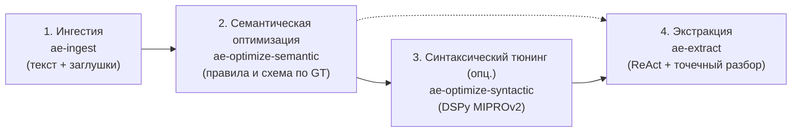
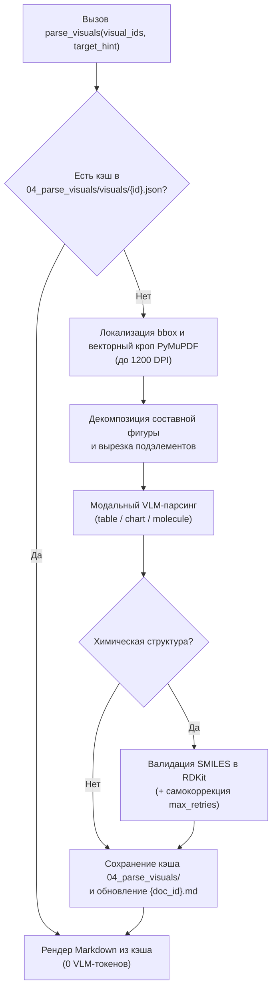
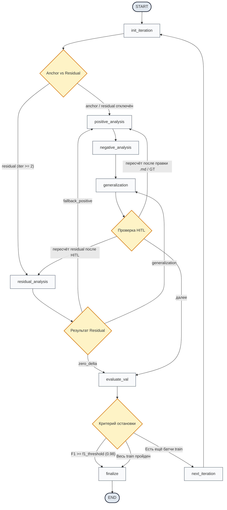
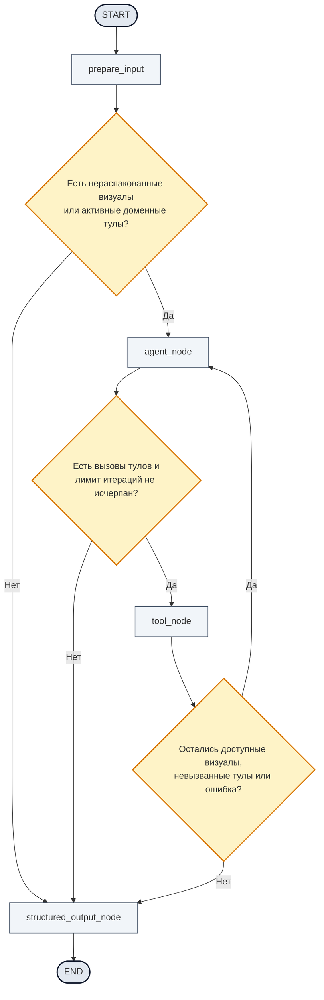
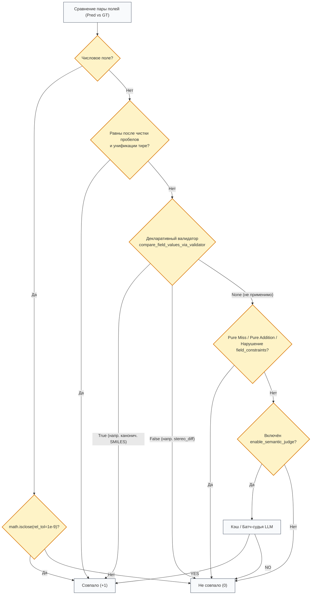

# Архитектура системы Adaptive Extractor

**Adaptive Extractor** — мультимодальная система извлечения структурированных табличных данных из научных PDF-статей по декларативной YAML-схеме. Документ описывает логику конвейера и устройство подсистем пакета [`src/ae/`](../src/ae).

### Содержание
- [0. Концепция и этапы конвейера](#0-концепция-и-этапы-конвейера)
- [1. Ингестия и визуальный инструмент (`ae.ingestion`)](#1-ингестия-и-визуальный-инструмент-aeingestion)
- [2. Оптимизация: семантический и синтаксический этапы (`ae.semantic_optimization` и `ae.syntactic_optimization`)](#2-оптимизация-семантический-и-синтаксический-этапы-aesemantic_optimization-и-aesyntactic_optimization)
- [3. Граф экстракции (`ae.extraction`)](#3-граф-экстракции-aeextraction)
- [4. Ядро и оценка (`ae.core`)](#4-ядро-и-оценка-aecore)
- [5. Единый глоссарий](#5-единый-глоссарий)

---

## 0. Концепция и этапы конвейера

Научные публикации неоднородны: факты распределены между текстом, многостраничными таблицами, графиками и химическими схемами. Предварительное распознавание всех иллюстраций тратит 80–90% бюджета на нерелевантные блоки (спектры, обзорные рисунки), ручные промпты дороги при переносе на новый домен, а грубый OCR теряет мелкие индексы и радикалы Маркуша.

Чтобы решить эти проблемы, система объединяет отложенное распознавание визуальных блоков и автоматическую двухэтапную адаптацию к задаче:



---

## 1. Ингестия и визуальный инструмент (`ae.ingestion`)

Подсистема [`ae.ingestion`](../src/ae/ingestion) разделена на два контура, чтобы не тратить ресурсы VLM заранее:

1. **Первичный проход (`ae-ingest`, оркестратор [`GeminiParser`](../src/ae/ingestion/parsers/gemini/parser.py))** — выполняет лёгкие стадии 01 и 02:
   - по одной странице транскрибирует текст в Markdown и расставляет якоря визуальных блоков (`parse_text`);
   - рендерит компактные превью страниц (длинная сторона до 768 px через PyMuPDF), классифицирует иллюстрации (`table`, `chart`, `molecular_structure`, `mixed`) и сохраняет чистый манифест с аннотациями-заглушками (`manifest_enriched_text.md`).
2. **Ленивая распаковка по запросу (`parse_visuals` → `VisualParsingService`)** — запускается из графа экстракции или при семантической оптимизации только для нужных `visual_id`.

Пример заглушки в рабочем Markdown:

```markdown
<visual id="Table_1" type="table">
Table 1. Antibacterial activity of benzimidazole derivatives 4a-4l
> MIC values (ug/mL) against S. aureus and E. coli for compounds 4a-4l.
</visual>
```

### Артефакты ингестии и кэширование

Класс [`ArtifactManager`](../src/ae/ingestion/parsers/gemini/artifacts.py) сохраняет результаты в `data/interim/ingestion/{doc_id}/` по стадиям (`01_parse_text/`, `02_manifest_visuals/`, `03_segment_and_crop_visuals_elements/`, `04_parse_visuals/` и `debug/`). Повторный запуск поддерживает выборочный сброс через `--from-stage` и обратную совместимость с legacy-каталогом `atoms/`.

### Инструмент `parse_visuals`

Фабрика [`make_visual_parsing_tool`](../src/ae/ingestion/tool.py) создаёт инструмент для ReAct-агента поверх [`VisualParsingService`](../src/ae/ingestion/service.py):
- В рабочем режиме извлечения (`inference`) принимает `visual_ids` и опциональный `target_hint` (например, конкретную панель рисунка); при частичном разборе возвращает оставшиеся нераспакованные подэлементы.
- В режиме `semantic_optimization` параметр `target_hint` скрыт, а подэлементы всегда разворачиваются до корневого рисунка целиком.



Ключевые механизмы (настраиваются в [`config/ingestion.yaml`](../config/ingestion.yaml)):
- **Адаптивный векторный кроп:** разрешение повышается от 300 до 1200 DPI, пока длинная сторона вырезки не достигнет 2000 px.
- **Валидация RDKit ([`rdkit_validation.py`](../src/ae/ingestion/parsers/gemini/stages/rdkit_validation.py)):** проверяет синтаксис и валентность SMILES; при ошибке запускает самокоррекцию с текстом диагностической ошибки.
- **Изоляция прогонов:** перед обработкой документа рабочий `{doc_id}.md` всегда сбрасывается к чистым заглушкам стадии 02, а уже распознанные блоки подтягиваются из кэша `04_parse_visuals/` за 0 VLM-токенов.

---

## 2. Оптимизация: семантический и синтаксический этапы (`ae.semantic_optimization` и `ae.syntactic_optimization`)

Оптимизация разделена на два уровня:
1. **Семантическая оптимизация (`ae-optimize-semantic`, основной этап)** — выводит доменные правила («что и по каким критериям извлекать») и уточняет схему по примерам из GT. Даёт главный скачок качества ([см. ADR-002](journal.md#adr-002-семантическая-оптимизация-anchor--residual-с-hitl-как-основной-контур-и-опциональный-dspy-miprov2-2026-11-принято)).
2. **Синтаксическая оптимизация (`ae-optimize-syntactic`, опционально)** — подбирает формулировки инструкции и `few-shot`-примеры с помощью DSPy MIPROv2 под конкретную (например, более лёгкую) Student-модель.

### Семантическая оптимизация (`SemanticOptimizationGraph`)

Граф [`SemanticOptimizationGraph`](../src/ae/semantic_optimization/graph.py) обрабатывает обучающую выборку батчами строго в порядке `splits.json`.

- **Режим Anchor (итерация 1):** полный контрастивный разбор расхождений с эталоном по строкам и колонкам.
- **Инкрементальный режим Residual (итерация ≥ 2):** на новых документах сначала запускается текущий кандидат инструкции. При высоком качестве без расхождений (`F1 ≥ residual_skip_f1`, 0.98) документ пропускается; при критическом провале (ниже 0.35) уходит в полный разбор; в остальных случаях [`residual_analysis.py`](../src/ae/semantic_optimization/steps/residual_analysis.py) анализирует только несовпавшие поля, пропуски и лишние строки, перенося стабильные области правил через carry-forward за 0 вызовов LLM.



Основные шаги внутри цикла:
1. **Подготовка визуалов и стратификация строк ([`visual_prep.py`](../src/ae/semantic_optimization/steps/visual_prep.py)):** целиком распаковываются только иллюстрации, связанные с GT и конкурирующими кандидатами (Tier 1); остальные блоки остаются заглушками (Tier 2). Для плотных таблиц выбирается репрезентативное подмножество строк (до `max_rows_per_doc`), а негативный анализ проверяет пропуски по полному документу. Логи пишутся в `research/experiments/_runtime/logs/llm/`.
2. **Генерализация, HITL и гармонизация ([`generalization.py`](../src/ae/semantic_optimization/steps/generalization.py), [`hitl.py`](../src/ae/semantic_optimization/hitl.py), [`schema_refinement.py`](../src/ae/semantic_optimization/steps/schema_refinement.py)):** синтезируются правила по строкам и колонкам, спорные конфликты с дедупликацией тем передаются эксперту в терминал (до 2 раундов HITL с возможностью правки GT или текста), затем промпт гармонизируется и выводятся уточнённые ограничения схемы (`generated_schema.yaml`).
3. **Валидация и воспроизводимый `--resume`:** прогресс проверяется по `F1` на `val`-сплите. Хэши документов и этапов (`.sha256`) строятся по каноническому манифесту стадии 02, чтобы прерванный запуск восстанавливался без лишних вызовов LLM.

### Опциональный синтаксический тюнинг (DSPy MIPROv2)

Адаптер [`UniversalExtractor`](../src/ae/extraction/agent.py) оборачивает граф LangGraph в `dspy.Module`, позволяя [`CheckpointingMIPROv2`](../src/ae/syntactic_optimization/mipro.py) оптимизировать инструкции и демонстрации через Optuna TPE с логированием в MLflow и поддержкой чекпоинтов при прерывании:

| Режим демонстраций | `max_bootstrapped_demos` | `max_labeled_demos` | Что попадает в промпт |
| :--- | :---: | :---: | :--- |
| Zero-Shot *(чистый тюнинг текста)* | 0 | 0 | Примеров нет; оптимизируется только инструкция |
| Pure Labeled *(по умолчанию)* | 0 | ≥ 1 | Бутстрэппинг отключён; используются только эталонные примеры |
| Pure Bootstrapped | B > 0 | 0 | Только трассы рассуждений, сгенерированные Teacher LLM |
| Hybrid | B > 0 | L > B | До B трасс с рассуждениями + сырые эталоны до L |

Обученный агент сохраняется через [`AgentManager`](../src/ae/extraction/manager.py) в `data/processed/agents/`.

---

## 3. Граф экстракции (`ae.extraction`)

Этап пакетного извлечения (`ae-extract`) работает на конечном автомате LangGraph ([`ExtractionGraph`](../src/ae/extraction/graph.py)):



Назначение узлов графа:
1. **`prepare_input`:** сбрасывает рабочий Markdown к чистым заглушкам стадии 02, собирает сводку схемы и активирует доменные инструменты (например, `assemble_markush_smiles`, если в тексте есть шаблоны Радикалов Маркуша `[*:1]`). Если распаковывать нечего и активных тулов нет, граф сразу переходит к структурированному выводу.
2. **`agent_node` и `tool_node`:** агент выбирает только релевантные визуалы; бюджет рассуждений на шаге маршрутизации ограничен параметром `agent_thinking_level` (`low` в [`config/extraction.yaml`](../config/extraction.yaml)). Повторные и зациклившиеся вызовы дедуплицируются (до 2 попыток на блок), а когда доступные визуалы и тулы исчерпаны, холостые шаги отсекаются напрямую в финал.
3. **`structured_output_node`:** разделяет статический префикс промпта и динамический хвост для кэширования префиксов API, поддерживает потоковый пакетный вывод (`structured_output_batch_size`, до 10 порций) для длинных статей, прогоняет проверки адекватности ([`sanity.py`](../src/ae/extraction/sanity.py) — битые символы, чужие алфавиты, повтор строк > 85%, валидаторы полей) и точечно ремонтирует только сбойные строки без перегенерации всего документа.

---

## 4. Ядро и оценка (`ae.core`)

Модуль [`ae.core`](../src/ae/core) содержит доменно-независимый фундамент системы.

### Оценка качества (`TaskMetric` и `RecordMatcher`)

[`metrics.py`](../src/ae/core/evaluation/metrics.py) и [`matcher.py`](../src/ae/core/evaluation/matcher.py) сначала оптимально выравнивают предсказанные и эталонные записи Венгерским алгоритмом (`scipy.optimize.linear_sum_assignment` с учётом `float_tolerance` и кратности 10±3/±6/±9), а затем проверяют каждое поле каскадом фильтров:



- **Числа:** строгая близость (`rel_tol = 1e-9`), при выравнивании строк учитывается допуск `float_tolerance` из схемы.
- **Детерминированный отсев и плагины:** пустые пропуски, лишние поля при `GT = null` и нарушения ограничений схемы сразу отклоняются; предметную эквивалентность проверяют подключаемые валидаторы (например, сравнение 2D-графов SMILES с контролем стереохимии в [`chemistry.py`](../src/ae/core/schema/domain_validators/chemistry.py)).
- **Батчевый `SemanticJudge`:** оценивает только действительно спорные пары с учётом связанных полей (значение + единица) и кэширует вердикты в рамках документа и прогона, после чего вычисляет `Precision`, `Recall` и `F1`.

### Схемы, хранилище и LLM-инфраструктура

- **Схемы и плагины ([`ae.core.schema`](../src/ae/core/schema/config.py)):** динамическая сборка Pydantic-моделей из YAML и ленивые реестры валидаторов и доменных инструментов.
- **Хранилище ([`ae.core.storage`](../src/ae/core/storage/__init__.py)):** 5 репозиториев для документов, Ground Truth, упорядоченных сплитов, версионированных агентов и результатов экстракции.
- **Конфиги и LLM ([`ae.core.config`](../src/ae/core/config/loader.py), [`ae.core.llm`](../src/ae/core/llm/provider.py)):** слияние `config/*.yaml` и `.env`, унифицированный учёт `usage` (включая кэшированные и reasoning-токены), автоматическое кэширование префиксов в DSPy, `CircuitBreaker` и запись логов через [`history_logger.py`](../src/ae/core/llm/history_logger.py).

---

## 5. Единый глоссарий

| Термин | Значение в проекте |
| :--- | :--- |
| **Эталонная разметка (Ground Truth, GT)** | CSV-таблица с проверенными ответами эксперта для обучения и оценки. |
| **Сплиты (`train`, `val`, `test`)** | Разделение статей: обучение, контроль прогресса / ранняя остановка и независимый тест. |
| **Отложенное распознавание (Lazy Ingestion)** | Быстрая оцифровка текста PDF с заменой иллюстраций на компактные текстовые заглушки. |
| **Распаковка по запросу (`parse_visuals`)** | Инструмент ReAct-агента для векторной вырезки и разбора нужной фигуры с кэшем в `04_parse_visuals/`. |
| **Семантическая оптимизация (RE)** | Этап `ae-optimize-semantic`: автоматический вывод предметных правил и ограничений схемы из расхождений с GT. |
| **Режим Anchor + Residual** | Гибридная стратегия: полный контрастивный разбор на 1-й итерации и фокус на оставшихся ошибках на следующих. |
| **Участие эксперта (HITL)** | Интерактивное разрешение спорных конфликтов в терминале с сохранением правил и опциональной правкой GT. |
| **Student / Teacher LLM** | Модель-исполнитель извлечения (*Student*) и сильная модель-наставник для анализа правил и промптов (*Teacher*). |
| **UniversalExtractor** | Адаптер между `dspy.Module` (для MIPROv2) и графом LangGraph `ExtractionGraph`. |
| **Sanity Checks и локальный ремонт** | Отлов битых символов, посторонних алфавитов и зацикливаний с точечной перегенерацией только сбойных строк. |
| **TaskMetric и SemanticJudge** | Метрика `F1` поверх Венгерского сопоставления с жёсткими правилами, плагинами и батчевым LLM-судьёй. |
