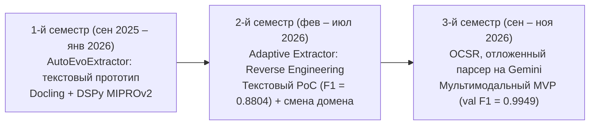

# Журнал эволюции проекта и архитектурные решения (ADR)

Документ фиксирует исследовательскую рамку проекта (`CCQH` и критерии зрелости `PoC → MVP → Product`), хронологию развития **Adaptive Extractor** (сентябрь 2025 – ноябрь 2026), статус предметных доменов и ключевые архитектурные решения (`ADR-001..005`). Сводный реестр прогонов собран в [`research/experiments/README.md`](../research/experiments/README.md), аудиты разметки — в [`gt_audits/`](../research/experiments/gt_audits/README.md), а литературный обзор — в [`docs/literature.md`](literature.md).

---

## 1. Исследовательская рамка (`CCQH`) и стадии зрелости (`PoC → MVP → Product`)

- **Контекст (Context):** научные факты распределены по публикациям в неоднородных формах (текст, таблицы, графики, химические схемы, *Supporting Information*). Для обучения моделей ML и пополнения баз знаний их нужно переводить в строгий табличный формат.
- **Проблема (Challenge):** специализированные системы (такие как `nanoMINER`) точны в одной области, но плохо переносятся на новые задачи из-за жёстких правил, ручных промптов, зашитых в код схем, дообучения NER и узких visual-моделей.
- **Вопрос (Question):** как построить систему экстракции научных данных, сохраняющую качество специализированных решений при минимальных затратах на перенос к новой задаче, схеме, домену или источнику свидетельств?
- **Гипотеза (Hypothesis):** **Adaptive Extractor** снизит стоимость переноса, если отделить переиспользуемое доменно-независимое ядро от декларативной схемы и автоматического слоя настройки инструкций, ограничений и визуальных инструментов по эталонным примерам.

| Стадия | Цель стадии | Критерии приёмки | Текущий статус |
| :--- | :--- | :--- | :--- |
| **`PoC`** | Доказать базовый принцип (ядро + автоматическая настройка достигают уровня ручных промптов) на одном сценарии | `PoC-C1` проверяемость гипотезы; `PoC-C2` существенность адаптации; `PoC-C3` реализуемость; `PoC-C4` валидное сравнение с бейзлайном; `PoC-C5` воспроизводимость; `PoC-C6` переход к MVP | **Закрыт** *(текст, `nanozymes`: Mean F1 = 0.8804 vs 0.6592, p = 0.00037)* |
| **`MVP`** | Минимальная мультимодальная версия для повторяемого применения с интерфейсами, диагностикой, кэшем и учётом цены | `MVP-C1` повторяемость в классе задач; `MVP-C2` контролируемая стоимость; `MVP-C3` стабильность качества; `MVP-C4` устойчивость контрактов; `MVP-C5` накопление знаний; `MVP-C6` готовность к Product | **Активен** *(`benzimidazole_antibiotics`: val Micro-F1 = 0.9949)* |
| **`Product`** | Полноценный перенос на новые домены, схемы и модальности без ручной пересборки ядра | `P-C1` качество/полнота; `P-C2` переносимость; `P-C3` расширяемость по модальностям; `P-C4` устойчивость; `P-C5` эффективность по цене/latency; `P-C6` эксплуатация; `P-C7` переиспользование артефактов | **Запланировано** *(след. шаг: перенос на `chelate_metal_complexes`)* |

---

## 2. Хронология развития R&D

### 1-й семестр (сен 2025 – янв 2026): `AutoEvoExtractor` и текстовый прототип
- **Постановка задачи и стек:** проанализированы 24 научные работы ([`docs/literature.md`](literature.md)); выбран стек **DSPy + MIPROv2** (*Teacher — Student*), парсер **Docling**, модели `gpt-oss:120b` и `mistral-small3.1-24b`, Венгерское выравнивание и стратификация корпуса `ChemX: nanozymes`.
- **Первые замеры:** ручной бейзлайн `M1` показал оптимум на 1-shot (F1 = 0.5811; 2-shot просел по precision из-за шума), а пробный запуск `MIPROv2` на 70 триалах дал Val F1 = 0.69 и Test F1 = 0.57 ([`2026-01-30_nanozymes_text_baseline_m1`](../research/experiments/2026-01-30_nanozymes_text_baseline_m1/report.md)).

### 2-й семестр (фев – июл 2026): `Adaptive Extractor`, Reverse Engineering и закрытие PoC
- **Архитектура и парсеры (февраль – апрель):**
  - Код переведён на Clean Architecture и YAML-конфиги; добавлены батчевый `SemanticJudge` и провайдер `OpenRouter`.
  - Сравнение 6 PDF-парсеров ([`2026-03-15_pdf_parsers_comparison`](../research/experiments/2026-03-15_pdf_parsers_comparison/report.md)) выявило искажения таблиц и формул в OCR-парсерах (`Docling`, `MinerU`, `Marker`, `Uni-Parser`), и 15 марта система перешла на **Gemini 3 Flash**.
  - Пилот к 15 апреля (`Qwen3.5-27B` / `397B`, 25 триалов) поднял F1 с 0.7810 до 0.8492 ([`2026-04-15_nanozymes_mipro_pilot`](../research/experiments/2026-04-15_nanozymes_mipro_pilot/report.md)).
- **Семантический прорыв и статистика PoC (май – июль):**
  - Аудит 239 расхождений на `nanozymes` ([`gt_audits/nanozymes.csv`](../research/experiments/gt_audits/nanozymes.csv)) показал, что синтаксический перебор не способен вывести скрытые правила разметки (масса vs концентрация, `syngony`, включение экспериментов). В июне был создан `Contrastive Analysis`, переросший в **Semantic Reverse Engineering**.
  - Итоговый бенчмарк 2-го семестра на 15 стратифицированных статьях (`Qwen3.5-27B`, критерий Фридмана χ² = 39.26, p = 1.53e-8, [`2026-07-01_nanozymes_re_vs_mipro_benchmark`](../research/experiments/2026-07-01_nanozymes_re_vs_mipro_benchmark/report.md)):
    - `Baseline (nanoMINER)` — Mean F1 = 0.6329 (Median 0.6452);
    - `Baseline (Manual)` — Mean F1 = 0.6592 (Median 0.6500);
    - **`Reverse-engineered`** — **Mean F1 = 0.8804** (Median 0.9032; vs Manual: `p_Holm = 0.00037`);
    - `Reverse-engineered + MIPROv2` — Mean F1 = 0.8811 (Median 0.8750; vs `RE`: `p_Holm = 0.55009`, прирост незначим).
- **Переход к визуалу и смена домена:** после оценки 7 концепций визуального модуля (см. [ADR-001](#adr-001-отложенный-двухконтурный-парсинг-pdf-с-декомпозицией-на-базе-gemini-вместо-mineru-и-специализированных-ocsr-2026-10-принято)) и временного теста `MinerU` 5 июля основным доменом выбран корпус **`benzimidazole_antibiotics`** (сложные таблицы MIC, графики и структуры Маркуша); параллельно подготовлен корпус `chelate_metal_complexes`.

### 3-й семестр (сен – ноя 2026): OCSR, отложенный парсинг и мультимодальный MVP
- **OCSR-бенчмарки и отложенный парсинг (сентябрь – октябрь):**
  - Временная контейнеризация и локальный `Transformers`-провайдер удалены ради быстрых итераций на API-стеке.
  - В октябрьской серии OCSR-экспериментов ([`2026-10-29_ocsr_gemini_benchmarks`](../research/experiments/2026-10-29_ocsr_gemini_benchmarks/report.md)) на 30 структурах доказан вред `thinking_level: "high"` (расход токенов +4.55× у `3.8-flash` и падение точности у `3-flash-preview` с 0.9333 до 0.7333), исключено семейство `Lite` и подтверждён скачок качества декомпозиции `complex → isolated` (с 0/4 на целом рисунке до 4/4 и 6/6).
  - Вместо `MinerU` и узких OCSR (`Glyph`, `COMO`, `DECIMER`) реализован единый двухконтурный парсер на `Gemini 3.8 Flash` (`GeminiParser` + ленивый инструмент `parse_visuals`).
- **Агентный граф, аудит и MVP (ноябрь):**
  - Экстракция переведена на ReAct-граф `ExtractionGraph` с кэшем `04_parse_visuals/`.
  - Семантическая оптимизация получила гибридный режим `Anchor + Residual` (ускорение в ~5.2×), HITL-триаж и уточнение схемы; `DSPy MIPROv2` переведён в опциональный этап, а химия изолирована в плагинах.
  - Аудит GT по антибиотикам (70 кейсов в [`gt_audits/benzimidazole_antibiotics.csv`](../research/experiments/gt_audits/benzimidazole_antibiotics.csv)) и устранение дефектов Блоков 1–6 после прогона [`2026-11-20`](../research/experiments/2026-11-20_benzimidazole_hybrid_run/report.md) (Micro-F1 = 0.9826) довели контрольный прогон [`2026-11-21`](../research/experiments/2026-11-21_benzimidazole_post_audit_eval/report.md) на `val` до **Micro-F1 = 0.9949** и **Macro-F1 = 0.9952** при ускорении валидации в 1.78× (29.7 → 16.7 мин).

---

## 3. Статус доменов (`PoC → MVP → Product`)

| Домен | Стадия и статус | Ключевые итоги | Следующий шаг |
| :--- | :--- | :--- | :--- |
| `nanozymes` | **Текстовый PoC — Закрыт** *(2 сем.)* | `Reverse-engineered` Mean F1 = 0.8804 (`p_Holm = 0.00037` vs 0.6592); 239 кейсов аудита | Архивный бенчмарк, новых запусков не планируется |
| `benzimidazole_antibiotics` | **Мультимодальный MVP — Активен** *(3 сем.)* | На `val`: **Micro-F1 = 0.9949**; 70 кейсов аудита GT | Ограничить JSON-черновики в `agent_node` и закрыть `test` (6 док / 287 строк) |
| `chelate_metal_complexes` | **В бэклоге** *(подготовлен)* | Корпус в `data/datasets/chelate_metal_complexes/` (907 строк GT, 21 PDF) | Перенос после закрытия `test` по антибиотикам (этап Product) |

---

## 4. Ключевые архитектурные решения (ADR)

### ADR-001. Отложенный двухконтурный парсинг PDF с декомпозицией на базе Gemini вместо `MinerU` и специализированных OCSR (2026-10, Принято)
- **Контекст:** при выборе архитектуры визуального модуля оценены 7 концепций по 12 критериям (C1 качество, C2 покрытие, C3 селективность, C4 низкие галлюцинации, C5 provenance, C6 auditability, C7 цена/latency, C8 совместимость, C9 переносимость, C10 простота R&D, C11 модульность, C12 воспроизводимость):

| Концепция | C1 | C2 | C3 | C4 | C5 | C6 | C7 | C8 | C9 | C10 | C11 | C12 | **Итого / 60** |
| :--- | :-: | :-: | :-: | :-: | :-: | :-: | :-: | :-: | :-: | :-: | :-: | :-: | :---: |
| A. Direct multimodal extractor | 4 | 5 | 2 | 1 | 1 | 1 | 2 | 2 | 3 | 5 | 1 | 2 | 29 |
| B. Text-first agent with visual tools | 4 | 5 | 4 | 2 | 3 | 3 | 3 | 5 | 4 | 3 | 5 | 2 | 43 |
| F. Type-specific visual modules | 5 | 5 | 4 | 4 | 5 | 5 | 2 | 3 | 2 | 2 | 5 | 4 | 46 |
| C. Visual evidence index + retrieval | 3 | 4 | 4 | 4 | 5 | 5 | 3 | 5 | 5 | 3 | 5 | 5 | 51 |
| D. Preliminary visual enrichment | 4 | 3 | 4 | 3 | 5 | 5 | 4 | 5 | 4 | 5 | 4 | 5 | 51 |
| **E. Verification-first visual module** | 3 | 3 | 5 | 5 | 5 | 5 | 4 | 5 | 5 | 4 | 5 | 5 | **54** |
| **G. Hybrid staged architecture** | 5 | 5 | 5 | 4 | 5 | 5 | 3 | 5 | 5 | 2 | 5 | 5 | **54** |

- Прямой мультимодальный прогон (`A`, 29/60) плох по provenance и стоимости; `MinerU` теряет LaTeX-индексы и требует GPU; узкие OCSR (`Glyph` 96.7%, `COMO` 93.3%, `DECIMER` 90.0%) не поддерживают схемы Маркуша и нехимические домены.
- **Решение:** объединить концепции **G** (поэтапная гибридная архитектура), **C** (индекс заглушек) и **E** (верификация) в двухконтурном парсере на `Gemini 3.8 Flash`: лёгкий проход текст + заглушки, затем ленивый `parse_visuals` (декомпозиция → векторный кроп до 1200 DPI → `low/medium` thinking → RDKit-контроль + кэш `04_parse_visuals/`).
- **Последствия:** переход от 0/4 к 100% точности за счёт кропинга ([`2026-10-29`](../research/experiments/2026-10-29_ocsr_gemini_benchmarks/report.md)), повторное чтение блоков за 0 VLM-токенов и отсечение нерелевантных иллюстраций.

### ADR-002. Семантическая оптимизация `Anchor + Residual` с HITL как основной контур и опциональный `DSPy MIPROv2` (2026-11, Принято)
- **Контекст:** основной скачок качества обеспечивает выведение скрытых правил (0.6592 → 0.8804), тогда как `MIPROv2` поверх них на `Qwen3.5-27B` статистически незначим (0.8804 → 0.8811, `p_Holm = 0.55009`), а полный повторный контрастивный анализ дорог.
- **Решение:** сделать `ae-optimize-semantic` (`Anchor` на 1-й итерации + `Residual` и carry-forward далее, 2-раундовый HITL и уточнение схемы) основным этапом, оставив `ae-optimize-syntactic` (`DSPy MIPROv2`) опциональным шагом для тонкой подстройки под слабые модели и `few-shot`.
- **Последствия:** ускорение семантических итераций в ~5.2× и выход на `val Micro-F1 = 0.9949` без запуска MIPROv2.

### ADR-003. Доменная независимость ядра через декларативные реестры плагинов (2026-11, Принято)
- **Контекст:** перенос системы между доменами выявил риск утечки химической лексики и RDKit-проверок в ядро.
- **Решение:** изолировать предметную логику в ленивых плагинах `FieldValidatorRegistry` и `ExtractionToolRegistry`, подключаемых из `config/schema.yaml`.
- **Последствия:** ядро графов и метрик остаётся универсальным; химия вынесена в `domain_validators/chemistry.py` и `domain_tools/chemistry.py`.

### ADR-004. Гибридный API-стек моделей (`Gemini 3.8 Flash` + `Qwen3.5-397B`) и отказ от локального `Transformers`/Docker (2026-11, Принято)
- **Контекст:** сопровождение SLURM/`Transformers` и Docker-образов замедляло разработку и не закрывало мультимодальный OCSR/парсинг.
- **Решение:** закрепить **Gemini 3.8 Flash** для ингестии, ReAct-экстракции и `SemanticJudge`, а **Qwen3.5-397B-A17B** (OpenRouter с prompt caching) — для рассуждений семантической оптимизации; удалить Docker и локальный `Transformers`.
- **Последствия:** быстрые итерации без GPU-инфраструктуры и прозрачный биллинг (`usage` + `agent_thinking_level: "low"`).

### ADR-005. Структура проекта по стандарту CCDS v2 и выделение `research/` (2026-11-21, Принято)
- **Контекст:** разрастание корневых папок, логов и разрозненных отчётов осложняло навигацию по проекту.
- **Решение:** свести корень репозитория к **7 директориям** (`config`, `data`, `docs`, `research`, `scripts`, `src`, `tests`), объединив `experiments/` (с `gt_audits/` и `_runtime/`), `notebooks/` и `references/literature/` под `research/` с умным `.gitignore`, централизовать конфиги в `pyproject.toml` и закрепить стандарты в [`docs/methodology.md`](methodology.md).
- **Последствия:** чистый корень, связность отчётов со снапшотами конфигов и строгая изоляция тяжёлых логов от Git.
